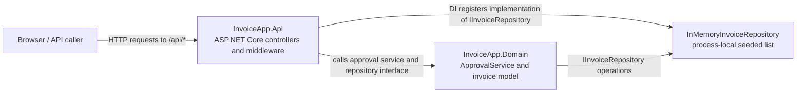
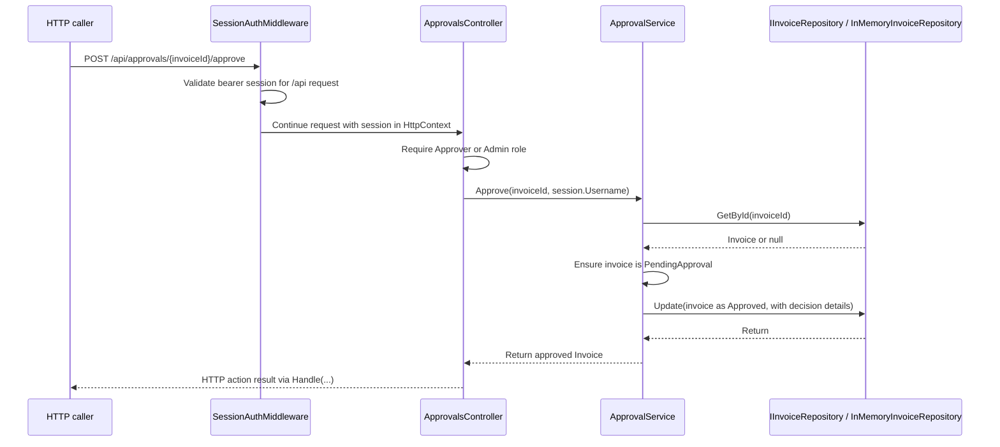

# Assignment point 1: architecture diagrams and test

This document separates the current implementation from the planned production
scenario. The as-built diagrams are based on repository source. Planned
components appear only in the target-state diagram.

## As-built container view



### As-built container citations

| Diagram element or interaction | Evidence |
| --- | --- |
| HTTP caller sends requests | API controllers define HTTP routes and verbs in `backend/src/InvoiceApp.Api/Controllers/InvoicesController.cs` (`InvoicesController`) and `backend/src/InvoiceApp.Api/Controllers/ApprovalsController.cs` (`ApprovalsController`). A specific browser call path is not established by these sources. |
| ASP.NET Core API, controllers and middleware | `backend/src/InvoiceApp.Api/Program.cs` (`WebApplication` setup, `UseMiddleware<SessionAuthMiddleware>`, `MapControllers`) |
| API to approval service | `InvoicesController` and `ApprovalsController` inject and call `ApprovalService`; `Program.cs` registers it as scoped. |
| API to repository implementation | `Program.cs` registers `IInvoiceRepository` as `InMemoryInvoiceRepository`; `InvoicesController` injects and invokes `IInvoiceRepository`. |
| Domain approval service and invoice model | `backend/src/InvoiceApp.Domain/ApprovalService.cs` (`ApprovalService`) and `backend/src/InvoiceApp.Domain/Invoice.cs` (`Invoice`) |
| Domain to repository abstraction | `ApprovalService` receives and calls `IInvoiceRepository`, declared in `backend/src/InvoiceApp.Domain/IInvoiceRepository.cs`. |
| In-memory implementation | `backend/src/InvoiceApp.Api/InMemoryInvoiceRepository.cs` (`InMemoryInvoiceRepository`); the repository is process-local and initialized with sample invoices. |

The repository is drawn as an implementation connected to the Domain
abstraction because `Program.cs` wires `IInvoiceRepository` to
`InMemoryInvoiceRepository`. The actual runtime call depends on that registered
implementation.

## As-built approval sequence

This is the approve branch. Rejection uses the analogous
`ApprovalsController.Reject` → `ApprovalService.Reject` path, additionally
requiring a reason.



### As-built sequence citations

| Diagram step | Evidence |
| --- | --- |
| Approve route and controller action | `backend/src/InvoiceApp.Api/Controllers/ApprovalsController.cs` (`[HttpPost("{invoiceId}/approve")]`, `Approve`) |
| Session validation and session availability | `backend/src/InvoiceApp.Api/Auth/SessionAuthMiddleware.cs` (`InvokeAsync`) and `HttpContextExtensions.GetSession`; middleware is installed in `backend/src/InvoiceApp.Api/Program.cs`. |
| Role authorization | `ApprovalsController` class attribute `[RequireRole("Approver", "Admin")]`; `backend/src/InvoiceApp.Api/Auth/RequireRoleAttribute.cs` (`RequireRoleAttribute`) |
| Controller passes invoice ID and username | `ApprovalsController.Approve` |
| Service retrieves invoice and checks state | `backend/src/InvoiceApp.Domain/ApprovalService.cs` (`Approve`, `Find`, `EnsurePending`) |
| Service records approval decision | `ApprovalService.Approve` sets status, approver, and timestamp, then calls repository `Update`. |
| Repository lookup/update implementation | `backend/src/InvoiceApp.Api/InMemoryInvoiceRepository.cs` (`GetById`, `Update`) and `backend/src/InvoiceApp.Domain/IInvoiceRepository.cs` |
| Controller maps service result | `ApprovalsController.Approve` calls `Handle(...)`, inherited from `backend/src/InvoiceApp.Api/Controllers/ApiControllerBase.cs` (`Handle`) |

## Inferred or unverified items

| Item | Why it is not established by the cited source |
| --- | --- |
| A particular browser or UI initiates the request | The controller defines the API route, but this diagram does not cite a frontend call site. The caller is therefore labeled generically as an HTTP caller. |
| Durability, concurrency guarantees, or cross-instance consistency | The current repository is in-memory and process-local; no persistent database behavior is shown. |
| Any publication to a queue or submission to PayEx | No such implementation is shown in the current code. These are not part of the as-built diagrams. |

Known response mapping (not an inference): `backend/src/InvoiceApp.Api/Controllers/ApiControllerBase.cs`
(`Handle`) maps success to 200, missing invoices to 404, invalid state to 409,
and argument errors to 400. Serialization details are not expanded here.

## Target-state view

The operations scenario describes an intended production platform. Solid nodes
are existing application elements; dashed nodes are planned or available but
not currently used by the application. The target deployment facts include
Azure App Service, Azure SQL, GitHub Actions, a provisioned Azure Service Bus,
and PayEx. Dashed relationships are explicitly unresolved connection points,
not asserted implementation details.

```mermaid
flowchart LR
    User["Approver / Admin (current roles)"]
    ExistingApi["Existing application API<br/>ASP.NET Core 8"]
    ExistingDomain["Existing domain<br/>Invoice approval lifecycle"]
    PlannedPersistence["PLANNED: Azure SQL<br/>Persistence design unspecified"]
    PlannedBus["AVAILABLE, NOT IN USE: Azure Service Bus<br/>Target use undecided"]
    PlannedPayEx["PLANNED: PayEx<br/>External payment provider"]
    PlannedPlatform["PLANNED hosting: Azure App Service"]
    PlannedCI["PLANNED platform: GitHub Actions<br/>Workflow details TBD"]

    User --> ExistingApi
    ExistingApi --> ExistingDomain
    ExistingApi -. "persistence connection TBD" .-> PlannedPersistence
    ExistingDomain -. "approved invoice submission; mechanism TBD" .-> PlannedPayEx
    PlannedPlatform -. "target hosting relationship" .-> ExistingApi
    PlannedCI -. "build/release relationship TBD" .-> PlannedPlatform

    classDef existing fill:#e8f5e9,stroke:#2e7d32,color:#111;
    classDef planned fill:#fff3e0,stroke:#ef6c00,stroke-dasharray: 5 5,color:#111;
    class User,ExistingApi,ExistingDomain existing;
    class PlannedPersistence,PlannedBus,PlannedPayEx,PlannedPlatform,PlannedCI planned;
```



### Target-state evidence and unresolved design

| Target item | Evidence / status |
| --- | --- |
| ASP.NET Core 8 application and current invoice lifecycle | Current source: `backend/src/InvoiceApp.Api/Program.cs`, API controllers, and `backend/src/InvoiceApp.Domain/ApprovalService.cs`. |
| Azure App Service, Azure SQL, GitHub Actions | Planned production scenario in `requirements/AI-in-SDLC-Home Assignment.md`; not all are represented as application dependencies in the current code. The repository also contains `.github/workflows/ci.yml`, but its relationship to the planned production deployment is not established. |
| Azure Service Bus | The assignment calls it provisioned but unused; `ops/README.md` describes a planned message topic. Its use in the target design is undecided, so no connection is drawn. |
| PayEx | The assignment describes a planned external integration and its timeout behavior. No PayEx client or submission path is present in the current code. |
| Azure SQL schema, transaction boundary, outbox, worker/consumer, retry policy, idempotency, message contract, PayEx lookup/reconciliation, and precise deployment wiring | Not specified by the source or scenario details cited above. Deliberately left unresolved rather than designed by inference. |

The target diagram's only proposed connections beyond the existing API-to-domain
call are the persistence relationship required by the scenario and the
approved-invoice submission relationship to PayEx. Their implementation
mechanisms remain explicitly unresolved. The available Service Bus is shown
without a connection because the scenario does not say it will be used.

## Architecture test

The structural rule is: **`InvoiceApp.Domain` must not reference
`InvoiceApp.Api`.** The test inspects the compiled Domain assembly references,
using the existing xUnit test project without adding a package.

Test source: `backend/tests/InvoiceApp.Tests/ArchitectureTests.cs`

Command:

```powershell
dotnet test backend/tests/InvoiceApp.Tests/InvoiceApp.Tests.csproj --filter FullyQualifiedName~ArchitectureTests
```

Result from this repository: **Passed** — 1 passed, 0 failed, 0 skipped.
